# Highly Available Web Architecture on AWS with Terraform

[](../../actions/workflows/terraform.yml)


A production-style, two-AZ web platform on AWS, built entirely as code: VPC with a NAT Gateway per AZ, a hardened bastion, an Application Load Balancer, an Auto Scaling Group that scales on CPU, and an S3-hosted site that **only the bastion can publish to** — enforced by a bucket policy that denies even an `AdministratorAccess` user.

The whole environment (41 resource blocks, 48 AWS resources) is created with one `terraform apply` in about 5 minutes and torn down with one script, so it costs nothing while idle.

> Built as the final project of an AWS course. I wrote the Terraform from scratch, stage by stage, and verified every stage against the live AWS account.

---

## Architecture

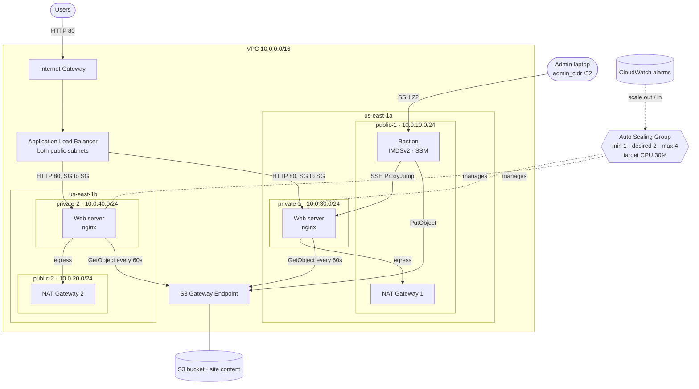

| Layer | Implementation | High availability |
|---|---|---|
| Network | VPC, 2 public + 2 private subnets across 2 AZs, IGW | Subnets in two AZs |
| Egress | One NAT Gateway **per AZ**, one private route table per AZ | Losing AZ-A does not cut AZ-B's egress |
| Entry | Internet-facing ALB, HTTP listener, target group with health checks | ALB nodes in both AZs |
| Compute | Launch Template + Auto Scaling Group in the private subnets | ELB health checks replace failed instances |
| Scaling | Target Tracking on `ASGAverageCPUUtilization = 30` | Scales 1 → 4 under load |
| Content | S3 bucket synced to every web server by a systemd timer | New instances pull the current site at boot |
| Admin | Bastion host + SSM Session Manager as a fallback | Bastion is management plane only; the site does not depend on it |

---

## Security highlights

Designed around the **AWS Well-Architected Security Pillar**:

- **No public IPs on servers.** `map_public_ip_on_launch = false`; only the bastion gets a public IP, explicitly.
- **Security group chain, SG-to-SG references.** Web servers accept HTTP **only from the ALB's SG** and SSH **only from the bastion's SG**. The ALB's egress is limited to port 80 towards the web SG. Default egress is removed and every egress rule is explicit.
- **SSH only from one IP.** `admin_cidr` must be a single `/32`, enforced by a variable `validation` block — `0.0.0.0/0` fails at plan time.
- **IAM roles, never access keys on servers.** Least privilege: web role = `s3:GetObject`; bastion role = upload. Credentials come from IMDS.
- **IMDSv2 required** (`http_tokens = "required"`) to block SSRF credential theft.
- **Encryption at rest**: encrypted gp3 EBS volumes, S3 SSE (AES256), full S3 Block Public Access.
- **Private key never leaves the laptop.** Generated with `ssh-keygen`, only the public key is uploaded — it is not in the Terraform state. Access to private servers uses `ssh -J` (ProxyJump), so no key is copied to the bastion.

### S3 challenge: three layers of explicit Deny

The bucket policy denies — and explicit Deny overrides any Allow, including `AdministratorAccess`:

| # | Statement | Condition | Effect |
|---|---|---|---|
| 1 | `DenyInsecureTransport` | `aws:SecureTransport = false` | No plain-HTTP access at all |
| 2 | `DenyUploadExceptBastion` | `aws:PrincipalArn` ≠ bastion role | Only the bastion can upload |
| 3 | `DenyContentAccessOutsideVpce` | `aws:SourceVpce` ≠ our Gateway Endpoint | Content is reachable only from inside the VPC |

Verified with negative tests from an admin laptop:

| Admin upload from laptop | Plain HTTP request |
|---|---|
| 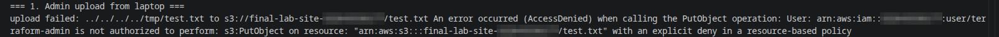 | 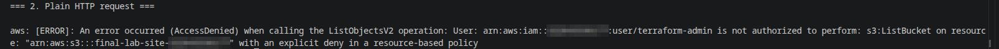 |

---

## Repository layout

```
.
├── versions.tf / providers.tf    # provider pin, region from variable
├── variables.tf                  # inputs + validation rules
├── data.tf                       # AZs, latest Ubuntu 24.04 AMI (Canonical), caller identity
├── network.tf                    # VPC, subnets, IGW, NAT per AZ, route tables, S3 endpoint
├── security.tf                   # 3 security groups, 7 rules
├── iam.tf                        # bastion and web roles, instance profiles, inline policies
├── compute.tf                    # key pair, bastion, launch template, ASG, scaling policy
├── alb.tf                        # ALB, target group, listener
├── s3.tf                         # bucket, public access block, encryption, bucket policy
├── outputs.tf
├── web_user_data.sh.tftpl        # nginx, AWS CLI, systemd timer that syncs the site from S3
├── site/                         # the two-page website
├── scripts/
│   ├── upload-site.sh            # publish site/ to S3 *through the bastion*
│   ├── stress-demo.sh            # CPU load + live view of the ASG scaling
│   └── session-end.sh            # terraform destroy + verify nothing billable is left
└── .github/workflows/terraform.yml   # fmt, validate, shellcheck, Checkov
```

---

## Usage

**Prerequisites:** Terraform ≥ 1.16, AWS CLI v2 with credentials for a dedicated IAM user, an SSH key pair.

```bash
# 1. Dedicated SSH key for the bastion (private key stays local)
ssh-keygen -t ed25519 -f ~/.ssh/final-lab-bastion

# 2. Your settings
cp terraform.tfvars.example terraform.tfvars   # set admin_cidr to your IP /32

# 3. Deploy (~5 minutes)
terraform init
terraform apply

# 4. Publish the site through the bastion
ssh-add ~/.ssh/final-lab-bastion
./scripts/upload-site.sh

# 5. Open the site
echo "http://$(terraform output -raw alb_dns_name)"

# 6. Tear everything down and verify
./scripts/session-end.sh
```

### Demos

```bash
# Load balancing across AZs: refresh and watch the instance and AZ change
curl -s http://$(terraform output -raw alb_dns_name)/whoami.html

# SSH to a private web server through the bastion (key never leaves the laptop)
ssh -J ubuntu@$(terraform output -raw bastion_public_ip) ubuntu@<web-private-ip>

# Auto scaling: load the servers, then watch desired capacity grow
./scripts/stress-demo.sh start
./scripts/stress-demo.sh watch
```

---

## Results

**Load balancing across two AZs** — the same URL is served by a different instance on refresh:

| us-east-1a | us-east-1b |
|---|---|
| 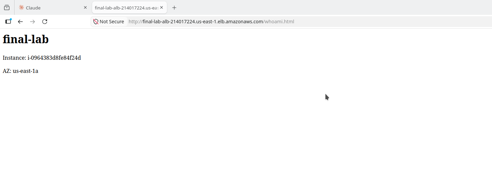 | 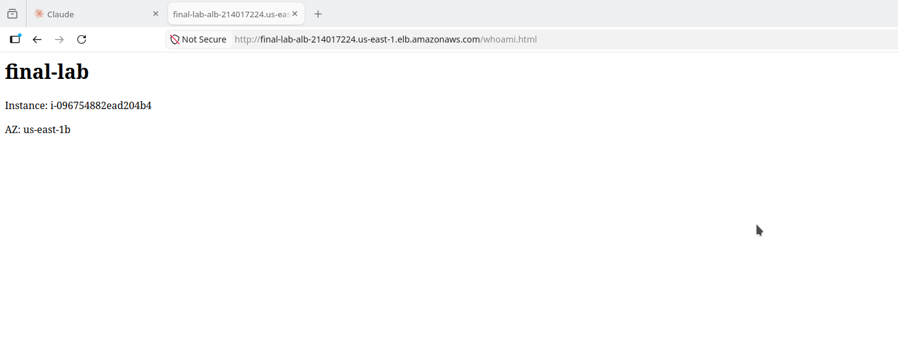 |

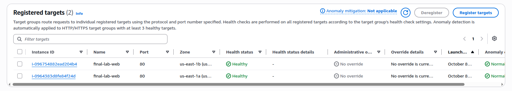

**Auto scaling on CPU.** `stress-ng` on the only running server → `AlarmHigh` fired → desired capacity went **1 → 4** in one step, spread over both AZs. After the load stopped, `AlarmLow` scaled it back down one instance per minute.

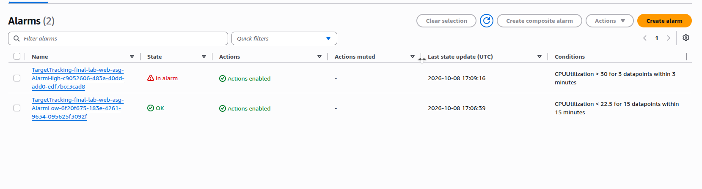
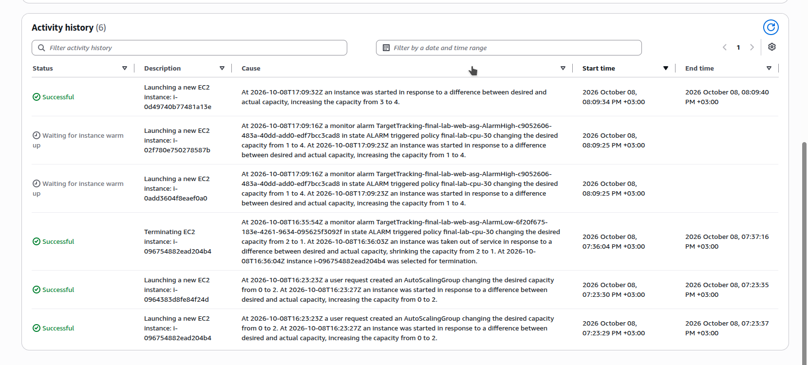

| CPU during stress | Scale in when idle |
|---|---|
| 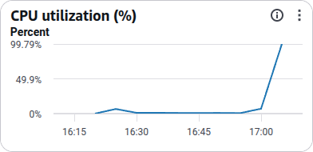 | 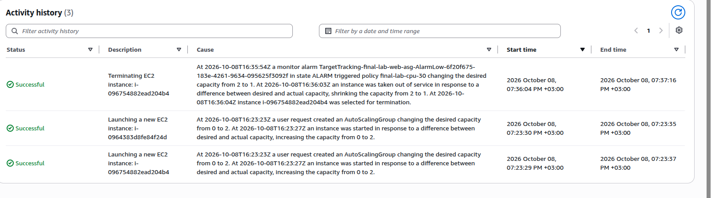 |

**Publishing from the bastion** — the site updates on every server within 60 seconds:

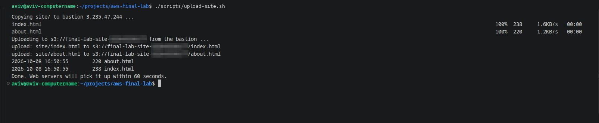
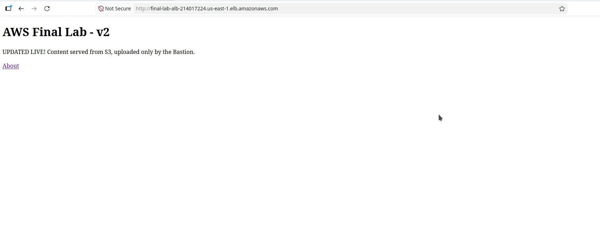

---

## Cost

About **$0.15–0.20 per hour** while running in us-east-1 (estimate — verify against current AWS pricing). Most of it is the two NAT Gateways and public IPv4 addresses, not EC2. That is why the workflow is *apply → work → destroy*; nothing is billed while the environment is down. `single_nat_gateway = true` trades AZ independence for a lower bill in dev.

---

## Lessons learned (real issues hit while building)

| Problem | Diagnosis | Fix |
|---|---|---|
| Web server booted without nginx on a fresh `apply` | `aws ec2 get-console-output`: `apt` timed out — the instance started before the NAT existed | `depends_on = [aws_route_table_association.private]`, then `terraform apply -replace` for the broken instance |
| First ASG creation in the account failed | `Access denied when attempting to assume role ... AWSServiceRoleForAutoScaling` — the service-linked role was created one second earlier and IAM had not propagated | The ASG retried and recovered; `terraform untaint` stopped Terraform from needlessly recreating it |
| Plan wanted to strip tags and `user_data` from an instance | Values came from the Launch Template, not the resource block (drift) | `lifecycle { ignore_changes = [...] }` |
| Scaling policy would be undone by the next `apply` | Target Tracking changes `desired_capacity` | `ignore_changes = [desired_capacity]` |
| A copied IAM policy passed `terraform validate` but was attached to the wrong role | `validate` checks syntax, not intent | Read every field in the plan, not just the summary line |

---

## What I would add next

- **HTTPS**: ACM certificate + 443 listener, redirect 80 → 443 (needs a domain).
- **Remote state**: S3 backend with state locking, so a team can share it safely.
- **`min_size = 2`** so the site stays in both AZs even when idle.
- **Health check on `/whoami.html`**, so instances stay healthy before the first site upload.
- VPC Flow Logs, S3 versioning, and modules (`network`, `compute`) for reuse.

---

**Author:** Aviv Levi · [GitHub](https://github.com/avivil0297)
